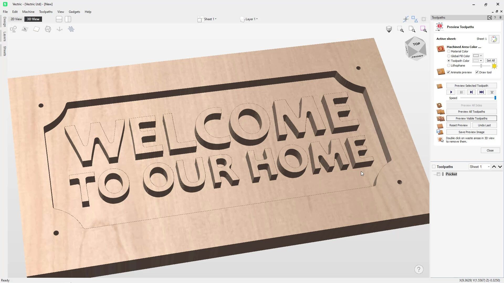
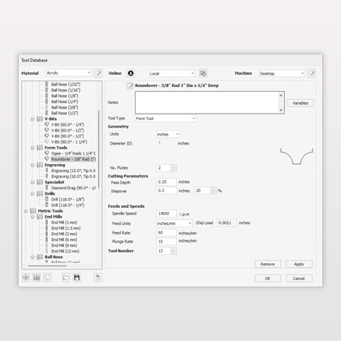

# Vectric VCarve Design and Toolpaths for CNC

[](https://vectric-vcarve.github.io/Vectric/)

Vectric develops VCarve for designing CNC projects and calculating machining toolpaths.
Vectric Vcarve combines vector drawing, imported artwork, and machining previews.

Use this guide to organize a project from its design geometry to its exported toolpaths.
The supplied files are a partial FreeCAD development collection.
They provide independent technical references rather than VCarve source code or an official SDK.

## Overview

A CNC project connects several decisions: the design, the stock, the cutter, and the machine.
Keep those decisions consistent as the job moves between design and machining stages.

VCarve supports 2D and 2.5D operations and machining of imported 3D models.
Its tools cover tasks such as profiling, pocketing, drilling, and V-carving.

- Define the material dimensions and job origin.
- Prepare clean vectors at the intended scale.
- Select tools appropriate to the geometry and material.
- Calculate each operation in a deliberate order.
- Inspect the preview before exporting toolpaths.
- Choose the post-processor for the intended controller.

Keep the editable design alongside exported machining files.
A toolpath export serves a different purpose from the project used to create it.

## Features

Choose an operation according to the shape you need to produce.

| Design goal | Relevant operation | Review focus |
| --- | --- | --- |
| Lettering and decorative grooves | V-carving | Cutter angle and feature detail |
| Recessed areas | Pocketing | Boundary and remaining material |
| Part outlines | Profiling | Cut side and part retention |
| Repeated holes | Drilling | Locations and specified depths |
| Imported relief work | 3D roughing and finishing | Model position and stock allowance |
| Decorative surface details | Fluting or texturing | Spacing and visible pattern |

Avoid using a single set of machining values for unrelated materials and cutters.
Use the tool supplier's guidance and the requirements of your own machine.



**Geometry preparation**

Check imported artwork for duplicate lines, open contours, and unexpected dimensions.
A drawing can look correct while still containing geometry that needs attention.

For comparison, the supplied FreeCAD build helpers identify geometry-related libraries:

- [SetupClipper2.cmake](cMake/FreeCAD_Helpers/SetupClipper2.cmake) configures Clipper2 integration.
- [SetupOpenCasCade.cmake](cMake/FreeCAD_Helpers/SetupOpenCasCade.cmake) locates the OpenCASCADE geometry kernel.
- [SetupEigen.cmake](cMake/FreeCAD_Helpers/SetupEigen.cmake) locates Eigen for numerical operations.

These references do not establish which libraries VCarve uses internally.

## Configuration

Confirm the active units, stock dimensions, and origin before calculating operations.
Check the tool definition against the cutter actually selected for the job.

- Match the cutter type and dimensions.
- Review the intended cut depth and operation boundaries.
- Confirm the coordinate reference used by the project.
- Keep operation names meaningful when several tools are involved.
- Recalculate affected toolpaths after changing the geometry.

An imported SVG can contain explicit dimensions and a separate viewBox.
The following standard Python example reads those attributes from an existing, trusted SVG.

```python
import xml.etree.ElementTree as ET

root = ET.parse("sign-layout.svg").getroot()
for attribute in ("width", "height", "viewBox"):
    print(f"{attribute}: {root.get(attribute, '(not specified)')}")
```

This reads XML metadata without changing the file.
It does not convert units, validate contours, or predict the dimensions VCarve will import.
Confirm the imported size inside the application.

The supplied FreeCAD files describe that project's interface and development configuration:

- [SetupQt.cmake](cMake/FreeCAD_Helpers/SetupQt.cmake) selects Qt components.
- [SetupCoin3D.cmake](cMake/FreeCAD_Helpers/SetupCoin3D.cmake) locates the Coin3D scene library.
- [SetupPython.cmake](cMake/FreeCAD_Helpers/SetupPython.cmake) configures Python discovery.
- [CMakePresets.json](CMakePresets.json) defines FreeCAD build presets.
- [settings.json](contrib/.vscode/settings.json) configures editor associations and analysis paths.

These are not VCarve preferences or installation requirements.

## Post-processors

A post-processor translates calculated toolpaths into output for a particular machine controller.
Select it according to the machine configuration rather than the desired filename alone.

Vectric provides a Post-Processor Manager for inspecting and selecting supported posts.
Its documentation also explains how customized copies differ from maintained posts.

- Confirm the controller and machine configuration.
- Check the units expected by the chosen post.
- Review how operations and tool changes are represented.
- Retain the project revision associated with an export.
- Revisit the post selection after changing the target machine.



A visual preview helps inspect the intended result.
Machine setup, workholding, and the selected tooling still need their own checks.

## Files Organisation

Keep a project package that another person can understand without reconstructing your decisions.

- Preserve the original artwork.
- Store the editable VCarve project separately from exports.
- Name exports by operation or tool when that helps identify them.
- Record the material and job revision.
- Keep notes about the chosen post-processor with the exported files.

The following PowerShell example compares an SVG with an existing copied version.
Replace both illustrative paths with the files you want to compare.

```powershell
$original = Get-FileHash -LiteralPath '.\sign-layout.svg' -Algorithm SHA256
$copy = Get-FileHash -LiteralPath '.\handoff\sign-layout.svg' -Algorithm SHA256
$original.Hash -eq $copy.Hash
```

A True result indicates matching SHA-256 hashes.
This checks file identity; it does not validate geometry or machining instructions.
The command belongs to PowerShell, not a VCarve command-line interface.

The supplied FreeCAD collection also includes project and editor metadata:

- [version.json](version.json) records FreeCAD version fields.
- [c_cpp_properties.json](contrib/.vscode/c_cpp_properties.json) defines C/C++ editor configuration.
- [tasks.json](contrib/.vscode/tasks.json) declares development tasks.
- [launch.json](contrib/.vscode/launch.json) defines debugger launch configurations.

These files support the reference project's development workflow.
The partial collection is not presented as a complete or tested FreeCAD build.

## Debugging

Separate design problems from toolpath calculation, export, and machine execution issues.
Start with the smallest project that demonstrates the unexpected result.

The supplied FreeCAD lint tools illustrate source-quality checks in that independent project:

- [black.py](tools/lint/black.py) processes Python formatting checks.
- [clang_format.py](tools/lint/clang_format.py) processes C/C++ formatting diagnostics.
- [generic_checks.py](tools/lint/generic_checks.py) checks text conventions such as line endings.
- [qt_connections.py](tools/lint/qt_connections.py) checks Qt signal and slot connection patterns.

They do not diagnose VCarve jobs or validate generated machining code.

## Reporting Issues

Include the product edition, version, input format, and operation involved.
State whether the issue appears in the design, preview, exported file, or machine behavior.

A useful example includes the expected result and a short sequence that reproduces the difference.
Remove unrelated geometry and confidential project information before sharing it.

## Usage & Getting Help

For vcarve pro comparisons, check the current edition matrix and supported workflows.
Searches for vectric vcarve desktop should be matched to Desktop documentation.
When following vcarve desktop examples, confirm that the instructions cover your installed version.

- [VCarve product information](https://www.vectric.com/products/vcarve/)
- [Vectric documentation](https://docs.vectric.com/docs/)
- [Post-Processor Management](https://docs.vectric.com/docs/V12.5/VCarveDesktop/ENU/Help/form/post-processor-management/index.html)
- [Vectric user forum](https://forum.vectric.com/)

## Related Search Terms

Vectric, Vectric Vcarve, vcarve pro, vectric vcarve desktop, vcarve desktop, cad, cam, cnc, toolpaths, engraving, v-carving, vector-design, machining, woodworking, windows
